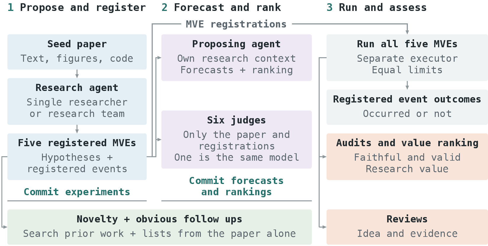

# rTaste: Do Research Agents Have Taste? Evaluating Early Stage Research Judgment

📄 Paper: TBD &nbsp;|&nbsp; 🤗 Dataset: TBD

**rTaste measures the *taste* of a research agent: its judgment of which experiments are worth running before their
outcomes are known.** Six frontier models read seven recent NLP papers and, working alone or as a team, each propose
five minimum viable experiments (MVEs). Before experiments are run, the agent registers an event for every MVE,
forecasts whether it will occur and ranks the five. A separate executor then runs all five, including those ranked
last, and model auditors judge the results. Of 415 MVEs, 194 are judged sound, valuable and new, but fewer than half
of these (73) also go beyond the seed paper with an experiment that is not obvious. The agents' first choice is the
auditors' most valued MVE more often than a random pick would be, but not measurably more often than the MVE they
wrote first.

<div align="center">

<br>
<sub>Before any MVE runs, the agent commits its five MVEs and then its forecasts and ranking. The judges see only the
seed paper and the registrations.</sub>
</div>

## How it works

- **Propose and register.** The agent gets the seed paper's text, an image of every page and read access to its
  code, and searches arXiv. A single researcher works in one context; a research team has two proposers draft, a
  critic review the drafts and a lead commit the five. Each registration states a hypothesis, the closest prior work
  and one registered event: a statistic passes a threshold set in advance.
- **Forecast and rank.** The agent gives each MVE a probability that its event will occur and ranks the five. Six
  judges, one of them the same model as the agent, do the same from the seed paper and the registrations alone. Two
  novelty judges check each MVE against prior work and against lists of obvious follow ups that each model wrote from
  the paper alone.
- **Run and assess.** One of two executors implements each MVE on one GPU under equal limits, and a rerun on a new
  machine decides whether the event occurred. Three auditors judge whether each MVE is faithful and valid, rate its
  research value and rank the five. Three reviewers then judge the idea and the evidence.

## Results

| Model (SR / RT) | Sound, valuable and new, of five | Beyond the paper, non obvious | Informative evidence, % of sound | Registered event occurred, % of sound | Sound, valuable and new per $100 |
|---|---:|---:|---:|---:|---:|
| GPT-6 Astra | 2.57 / 3.29 | 21 / 21 | 55 / 55 | 24 / 16 | 15 / 11 |
| Claude Fable 5.1 | 2.43 / 2.86 | 3 / 4 | 67 / 80 | 57 / 53 | 9 / 6 |
| Claude Opus 5.5† | 3.33 / 3.14 | 2 / 8 | 87 / 72 | 53 / 44 | 14 / 8 |
| GPT-6.1 Sol | 3.00 / 3.71 | 20 / 22 | 61 / 88 | 27 / 33 | 30 / 28 |
| GPT-6 Luna | 0.71 / 2.00 | 6 / 7 | 33 / 44 | 33 / 25 | 8 / 25 |
| Muse Spark 1.3 | 0.14 / 1.00 | 5 / 7 | 39 / 45 | 39 / 38 | 2 / 11 |
| All | 2.00 / 2.67 | 57 / 69 | 57 / 64 | 38 / 35 | 13 / 11 |
| RT minus SR | +0.71 [−0.10, 1.52] | +12 | +7.0 | −3.7 | −2 |

<sub>SR: single researcher; RT: research team; seven seed papers. Sound, valuable and new: mean number of the five MVEs
of a condition. Beyond the paper and non obvious: number of MVEs. Sound: at least two of three auditors judge the MVE
faithful to its registration and valid. Valuable: a median research value of 2 or more out of 3. New: neither novelty
judge finds close prior work. Beyond the paper and non obvious, and informative evidence: at least two of three
reviewers say so. The interval is a 95% CI over seed papers. †Its single researcher ran on six seed papers (30 MVEs);
in the first column, RT minus SR counts the seventh as zero.</sub>

## Quick start

Reproduce every table and number in the paper from the released data, with no installs or API keys:

```bash
git clone https://github.com/ArtKanke/rTaste && cd rTaste
python3.12 analysis/tables.py
```

The data is in [`data/`](data/README.md): `mves.csv` has one row per MVE with every label and forecast, and
`mves.jsonl` holds the full text of each registration, audit and review.

To run the study yourself, you need API keys for OpenAI, Anthropic, xAI and Meta, and a Hugging Face account that
can start Jobs on GPU machines.

```bash
cp .env.example .env                                   # then fill in the keys
python3.12 -m venv .venv && .venv/bin/pip install -r requirements.txt && .venv/bin/pip install --no-deps -e .
.venv/bin/python -m pytest tests                       # offline tests
.venv/bin/python -m rtaste.run propose 2609.29233      # proposals, forecasts and rankings of all twelve conditions
.venv/bin/python -m rtaste.run execute 2609.29233      # implement and rerun every MVE
.venv/bin/python -m rtaste.run audit 2609.29233        # novelty, obvious follow ups, audits and value rankings
.venv/bin/python -m rtaste.run review 2609.29233       # the review of every delivered MVE
.venv/bin/python -m rtaste.run status 2609.29233       # progress and cost so far
.venv/bin/python -m analysis.build_dataset runs        # turn runs/ into data/
```

| Path | Contents |
|---|---|
| `rtaste/` | the evaluation harness: models, tools, proposing, forecasts, audits, execution, command line |
| `prompts/` | every prompt, as plain text |
| `seeds/` | how the seed papers were screened, and the order they ran in |
| `data/` | the dataset ([data/README.md](data/README.md) defines every column) |
| `analysis/` | `build_dataset.py` (runs to data) and `tables.py` (data to the paper's numbers) |
| `tests/` | tests |

## Citation

```bibtex
TBD
```

## License

The code is released under the [MIT License](LICENSE) and the data under CC BY 4.0. The seed papers and their code
belong to their authors; `data/` does not include their text or code, only short quotes.
